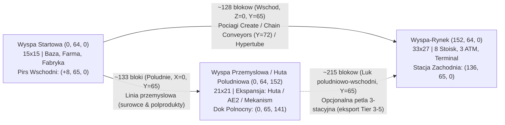

# ISLAND_DESIGN.md — Projekt układu wysp (*Skyblock Builder*)

Dokumentacja architektoniczna wielo-wyspowego Overworlda w modpacku **HalucynacjeGTP2** (*Create Skyblock Tycoon*, Minecraft `1.21.1`, NeoForge, Create `6.x`).

Układ wysp realizuje dwa kluczowe cele projektowe z [VISION.md](VISION.md):
1. **Naturalna motywacja do logistyki Create 6** — dystans **~150 bloków** przez pustkę sprawia, że budowa **Chain Conveyors + Frogports**, **wiaduktów kolejowych (`Create` / `Steam 'n' Rails`)** oraz **rur `Create: Hypertubes`** jest zarówno praktyczna, jak i widowiskowa.
2. **Bezpieczne i wydajne środowisko pod ekonomię (`Lightman's Currency` + `Shoppers`)** — Wyspa-Rynek jest w 100% płaska, ma rozproszone bankomaty (ATM) i zaplecze serwisowe pod taśmociągi, zgodnie z ustaleniami z [PROGRESSION_AND_ECONOMY.md](PROGRESSION_AND_ECONOMY.md) oraz RFC #5.

---

## 1. Mapa logistyczna — trójkąt 3 wysp Overworlda

Wszystkie 3 wyspy generują się na wspólnym poziomie bazowym **`y = 64`** (z jednolitym poziomem torowiska **`y = 65`**), dzięki czemu gracze mogą prowadzić proste, idealnie wypoziomowane wiadukty kolejowe oraz linie napowietrzne bez uciążliwego korygowania osi.



> **Ważna zasada wymiarów (Guardrail):** Pustką (*Void*) objęty jest **wyłącznie Overworld (`minecraft:overworld`)**. **Nether (`minecraft:the_nether`, odblokowywany w Stage 2)** oraz **End (`minecraft:the_end`, odblokowywany w Stage 4)** zachowują w pełni **normalną generację waniliową** (szczegóły w [world.json5](../config/skyblockbuilder/world.json5)).

---

## 2. Tabela koordynatów bazowych i punktów orientacyjnych

Koordynaty podane są względem punktu początkowego wyspy drużyny (`origin = (0, 64, 0)`). W `Skyblock Builder` wyspy satelickie definiowane są jako `spreads` z relatywnym przesunięciem (`offset`), więc przy wielu drużynach zachowują identyczny układ względny.

| Lokacja / Element | Koordynaty `(X, Y, Z)` | Wymiary / Przesunięcie | Przeznaczenie |
| :--- | :--- | :--- | :--- |
| **Wyspa Startowa — środek / spawn** | `(0, 64, 0)` | `15 × 15` (`X: -7..+7`, `Z: -7..+7`) | Punkt odrodzenia drużyny i startowa platforma Stage 0 |
| Drzewo startowe (Dąb) | `(-4, 65, -4)` | 1 drzewo na bloku ziemi | Pierwsze drewno, sadzonki, jabłka |
| Wnęka Cobble-Gen (Lód/Woda + Lawa) | `(-5, 64, +4)` | `4 × 3` (zagłębiona na `Y=63`) | Bezpieczny generator bruku (2× lód/woda + 1× lawa) |
| Skrzynia Startowa (opcjonalna zapasowa) | `(-2, 65, +2)` | `1 × 1` | Zapasowa sadzonka, kości/mączka, pochodnie |
| **Pirs Logistyczny Wschodni (Startowa)** | `(+8, 64, 0)` do `(+10, 64, 0)` | Tor `Y=65`, Maszt `Y=72` | Wyrównany wylot na wschód: tory, Chain Conveyor, Hypertube |
| **Wyspa-Rynek — centrum placu** | `(152, 64, 0)` | `33 × 27` (`X: 136..168`, `Z: -13..+13`), offset `[152, 0, 0]` | Główny hub handlowy: `Shoppers` NPC + `Lightman's Currency` |
| **Stacja Kolejowa Zachodnia (Rynek)** | `(136, 65, 0)` | Peron `5 × 9` (`X: 136..140`, `Z: -4..+4`) | Przyjazd pociągów ze Startowej (prosta oś `Z=0`, `Y=65`) |
| Terminal Hypertube (Rynek) | `(139, 65, -3)` | `2 × 2` | Szybki transport graczy na/z Wyspy Startowej |
| Pad pod Waystone (Rynek) | `(139, 65, +3)` | `2 × 2` | Odkrywany punkt teleportacji `Waystones` |
| Pawilon Centralny (`Trading Terminal`) | `(152, 64, 0)` | `5 × 5` (otwarta altana) | Hurtowy skup (`Creative Network Traders`) + katalog Żetonów Etapów |
| **Bankomat ATM #1 (Północny Zachód)** | `(146, 64, -8)` | Odstęp `12` bloków od ATM #2 | Obsługa wypłat gotówki NPC `Shoppers` bez kolejek |
| **Bankomat ATM #2 (Północny Wschód)** | `(158, 64, -8)` | Odstęp `12` bloków od ATM #1 | Obsługa wypłat gotówki NPC `Shoppers` bez kolejek |
| **Bankomat ATM #3 (Południe)** | `(152, 64, +10)` | Odstęp `>18` bloków od ATM #1/#2 | Trzeci punkt ATM dla równomiernego ruchu NPC |
| Stoiska Handlowe Północne (#1–#4) | `X: 143, 149, 155, 161`, `Z: -5` | 4 moduły `4 × 3` + korytarz tylny `Z: -9..-10` | Fizyczne sklepy `Lightman's Currency` zasilane od tyłu |
| Stoiska Handlowe Południowe (#5–#8) | `X: 143, 149, 155, 161`, `Z: +5` | 4 moduły `4 × 3` + korytarz tylny `Z: +9..+10` | Fizyczne sklepy `Lightman's Currency` zasilane od tyłu |
| **Wyspa Przemysłowa / Huta Południowa** | `(0, 64, 152)` | `21 × 21` (`X: -10..+10`, `Z: 142..162`), offset `[0, 0, 152]` | Opcjonalna płyta pod ciężką hutę, AE2 i Mekanism |
| **Dok Kolejowy Północny (Przemysłowa)** | `(0, 65, 141)` | Peron `9 × 4` (`X: -4..+4`, `Z: 141..144`) | Wyrównany w osi `X=0, Y=65` ze skrajem Wyspy Startowej |

---

## 3. Szczegółowy blueprint: Wyspa Startowa `(0, 64, 0)`

Wyspa Startowa ma dawać przyjemny, czysty start w klimacie **pure-Create Skyblock** (bez *Ex Deorum* / *Ex Nihilo*), a jednocześnie wizualnie podpowiadać kierunek ekspansji na wschód (ku widocznej na horyzoncie Wyspie-Rynkowi).

### Układ i budulec
- **Wymiary płyty:** ~`15 × 15` bloków (`X: -7..+7`, `Z: -7..+7`), górna warstwa trawy/ziemi na **`Y = 64`**, stożkowa podbudowa z kamienia, andezytu i deepslate'u schodząca do `Y = 58` (wygląd naturalnej latającej skały z industrialnym akcentem).
- **Strefa surowców początkowych (Stage 0):**
  - **Drzewo startowe** (`(-4, 65, -4)`): klasyczny dąb (*Oak Tree*) z kilkoma blokami trawy wokół pod wczesną trawę/nasiona.
  - **Wnęka Cobble-Gen** (`(-5, 64, +4)`): estetyczna kamienna niecka z **1 źródłem lawy** i **2 blokami lodu** (lub źródłem wody) gotowa do natychmiastowego uruchomienia bezpiecznego generatora bruku, a chwilę później — zamiany w `Create: Mechanical Extruder`.
  - **Skrzynia startowa** (`(-2, 65, +2)`): opcjonalne zapasowe zasoby wyspy (2× `minecraft:oak_sapling`, 4× `minecraft:bone_meal`, 1× `minecraft:bucket`, 8× `minecraft:torch`, 1× `minecraft:red_bed`). Ekwipunek osobisty gracza definiuje [inventory.json5](../config/skyblockbuilder/inventory.json5).
- **Pirs Logistyczny Wschodni `(+8, 64, 0)`:**
  - Krótki, 3-blokowy wypust (`X: +8..+10`, `Z: -2..+2`) z cegieł kamiennych i obramowania z andezytu (*Andesite Casing* / *Polished Andesite*).
  - **Poziom torowiska `Y = 65`:** ułożone 2 demonstracyjne odcinki `create:track` na `(+8, 65, 0)` i `(+9, 65, 0)` wskazujące dokładnie prosto na Stację Zachodnią Wyspy-Rynku `(136, 65, 0)`.
  - **Maszt Chain Conveyor `Y = 72`:** drewniano-andezytowy słup na `(+8, 64..72, -2)` z wyraźnym wspornikiem na wysokości `Y = 72`, gotowy do zawieszenia pierwszego `create:chain_conveyor` + `create:package_frogport` w Stage 1!
- **Bezpieczeństwo i oświetlenie:** 4 latarnie rozmieszczone w narożnikach wyspy (`(±6, 65, ±6)`), dzięki czemu w nocy na starcie nie pojawiają się potwory.

---

## 4. Szczegółowy blueprint: Wyspa-Rynek `(152, 64, 0)`

Wyspa-Rynek znajduje się **~150 bloków na wschód** (środek na `(152, 64, 0)`, zachodnia krawędź stacji na `X = 136`, czyli **128 bloków czystego przęsła** od Pirsu Wschodniego). Przy standardowym dystansie renderowania (10–12 chunków) wyspa jest **widoczna z Wyspy Startowej** — od pierwszej minuty stanowi jasny cel wizualny i inżynieryjny.

### Krytyczne zasady projektowe pod AI `Shoppers` i TPS Exaroton
Zgodnie z ustaleniami RFC #5 i [EXAROTON_AND_MAC_M2.md](EXAROTON_AND_MAC_M2.md):
1. **100% płaski plac handlowy (`Y = 64`):** cała strefa, po której poruszają się NPC `Shoppers` (`X: 141..167`, `Z: -12..+12`), jest **idealnie płaska** na poziomie `Y = 64`. **Zakaz schodów, półpłytek (slabs), płotków na środku alejek i uskoków o 1 blok** w strefie NPC — eliminuje to blokowanie się pathfindingu (AI) i obciążenie CPU serwera.
2. **Limit populacji NPC:** konfiguracja `Shoppers` ograniczona do **8–12 aktywnych klientów jednocześnie** (wysoki ruch wizualny przy minimalnym wpływie na TPS Exaroton).
3. **3 zatoki ATM rozstawione o >6 bloków:** NPC w `Shoppers` odwiedzają bankomat, gdy ich gotówka spadnie poniżej 500 miedzianych monet, i omijają zajęty blok w promieniu 1.5 kratki. Trzy bankomaty w punktach:
   - **ATM #1:** `(146, 64, -8)`
   - **ATM #2:** `(158, 64, -8)` *(12 bloków od ATM #1)*
   - **ATM #3:** `(152, 64, +10)` *(>18 bloków od ATM #1 i #2)*
   całkowicie eliminują korki i zatory pod bankomatami.
4. **Siatka oświetleniowa (Anti-Spawn Grid):** w nawierzchnię placu z `stone_bricks` i `polished_andesite` wbudowana jest regularna siatka ukrytych źródeł światła (*Sea Lantern* / *Glowstone* pod szarym dywanem lub *Create Brass Lantern* na kolumnach co 6 bloków), gwarantująca poziom światła **≥ 10 w każdym bloku** wyspy. Brak hostile mobów atakujących graczy lub zakłócających handel.

### Strefy funkcjonalne Wyspy-Rynku (schemat z góry)

```text
                       PÓŁNOC (Z = -13)
         +-------------------------------------------+
         |   [ Korytarz Serwisowy N: Z = -9..-10 ]   |  <- Taśmociągi / Packagery / Frogporty
         |    ATM#1 (146,-8)        ATM#2 (158,-8)   |  <- Zatoki ATM (płasko Y=64)
         |   [S1]     [S2]          [S3]     [S4]    |  <- 4 Stoiska Północne (Z = -5)
  ZACHÓD |                                           |  WSCHÓD
 [Peron] | [H]           +-----------+               | (X=168)
 (136,0) |=====  Aleja   | Trading   |   Plac        |  <- Oś główna Z=0 (szerokość 7 bloków)
 [Tor]   | [W]   Główna  | Terminal  |   Targowy     |     Pawilon (152, 64, 0)
         |               +-----------+               |
         |   [S5]     [S6]          [S7]     [S8]    |  <- 4 Stoiska Południowe (Z = +5)
         |                ATM#3 (152,+10)            |  <- Trzeci bankomat
         |   [ Korytarz Serwisowy S: Z = +9..+10 ]   |  <- Taśmociągi / Packagery / Frogporty
         +-------------------------------------------+
                      POŁUDNIE (Z = +13)

Legenda: [H] = Terminal Hypertube (139,65,-3) | [W] = Pad Waystone (139,65,+3) | [S1..S8] = Stoiska LC
```

### Detale techniczne stref Rynku
- **8 modularnych stoisk sklepowych (`S1`–`S8`):**
  - Każde stoisko ma front handlowy (`Lightman's Currency`: *Shelf*, *Display Case*, *Vending Machine* lub *Card Display*) skierowany ku głównej alei placu (`Z = -5` i `Z = +5`).
  - Bezpośrednio za ścianą tylną biegnie **zamknięty korytarz serwisowy dla graczy i maszyn** (`2` bloki szerokości na `Y = 64` + rampa napowietrzna na `Y = 68` dla `Chain Conveyors` / `Frogports` i `Chutes`). Dzięki temu gracze mogą podpiąć rozładunek pociągów (`Portable Storage Interface` -> `Packager` -> `Frogport` -> `Funnel` -> sklep LC) bez szpecenia alei i bez blokowania ścieżek NPC!
  - Sugerowany podział tematyczny 8 stoisk (elastyczny dla graczy):
    1. *Piekarnia & Śniadania* (Tier 1)
    2. *Bistro & Dania Obiadowe* (Tier 2 — *Farmer's Delight*)
    3. *Cukiernia & Czekolada* (Tier 3 — *Create: Confectionery* / *Create: Food*)
    4. *Sklep Mechaniczny* (Tier 4 — *Precision Mechanisms*, *Sturdy Sheets*)
    5. *Skład Kolejowy & Paliwa* (Tier 4 — *Tracks*, *Bioethanol*)
    6. *Elektronika AE2* (Tier 5 — *Processors*)
    7. *Przemysł Ciężki Mekanism* (Tier 5 — *Control Circuits*)
    8. *Stoisko Sezonowe / Nadwyżki* (dowolny asortyment drużyny)
- **Pawilon Centralny (`(152, 64, 0)`):**
  - Lekka, otwarta altana na 4 filarach (brak pełnych ścian blokujących widok i ruch NPC).
  - Zawiera **`Lightman's Currency` `Trading Terminal`** podłączony do globalnych **Creative Network Traders**:
    - skup hurtowy (stawki bazowe 100%, podczas gdy stoiska NPC `S1–S8` dają premię **+20%**),
    - katalog **Żetonów Etapów** (`10k / 50k / 100k / 250k / 1M` monet) oraz prestiżowego `create:creative_motor` po odblokowaniu Stage 5,
    - sklep rzadkich nasion, sadzonek i surowców bazowych (soft gating).
- **Stacja Kolejowa Zachodnia `(136, 65, 0)` + Hypertube + Waystone:**
  - Peron na `Y = 65` oddzielony niskim krawężnikiem/barierką od strefy NPC (`X = 140`), z otwartym przejściem dla graczy i miejscem na `Create Train Station`, `Portable Storage Interface` oraz buforowy `Item Vault`.
  - Obok peronu znajdują się wyznaczone stanowiska pod **Terminal `Create: Hypertubes`** (`(139, 65, -3)`) oraz **Waystone** (`(139, 65, +3)`), umożliwiające błyskawiczny powrót na Wyspę Startową.

---

## 5. Szczegółowy blueprint: Wyspa Przemysłowa / Huta Południowa `(0, 64, 152)`

Opcjonalna trzecia wyspa w układzie (`offset: [0, 0, 152]`, ~150 bloków na południe od Wyspy Startowej), pomyślana jako czysty fundament pod ciężką ekspansję w **Stage 2–5**:
- **Wymiary płyty:** idealnie płaska platforma **`21 × 21`** (`X: -10..+10`, `Z: 142..162`, nawierzchnia `Y = 64`) wykonana z `polished_deepslate`, `stone_bricks` i obramowania z `industrial_iron_block` / `andesite`.
- **Dok Kolejowy Północny `(0, 65, 141)`:**
  - Wyrównany w osi **`X = 0`, `Y = 65`** z południową krawędzią Wyspy Startowej (`(0, 65, +8)`).
  - Pozwala graczom wybudować **3-stacyjną pętlę kolejową** (Startowa -> Huta Południowa -> Rynek -> Startowa) i rozdzielić hałaśliwe linie ciężkie (Crushing Wheels, kotły parowe, reaktory Mekanism, farmy kryształów AE2) od estetycznej wyspy głównej — co dodatkowo **poprawia FPS na Apple Silicon Mac M2**, bo ciężkie animacje obracających się wałów znajdują się poza bezpośrednim centrum bazy!
- **Oświetlenie:** narożne i środkowe lampy przemysłowe zapewniające pełną ochronę przed spawnem potworów od momentu wygenerowania wyspy.

---

## 6. Powiązane pliki w repozytorium

- [schematics/README.md](../schematics/README.md) — instrukcja budowy i eksportu 3 szablonów `.nbt` w trybie Creative (Structure Block).
- [config/skyblockbuilder/world.json5](../config/skyblockbuilder/world.json5) — pusty Overworld + normalny Nether i End.
- [config/skyblockbuilder/templates.json5](../config/skyblockbuilder/templates.json5) — definicja `starter_island.nbt` oraz `spreads` dla Rynku i Huty Południowej.
- [config/skyblockbuilder/spawn.json5](../config/skyblockbuilder/spawn.json5) — parametry spawnu drużyny.
- [config/skyblockbuilder/inventory.json5](../config/skyblockbuilder/inventory.json5) — ekwipunek początkowy gracza.
