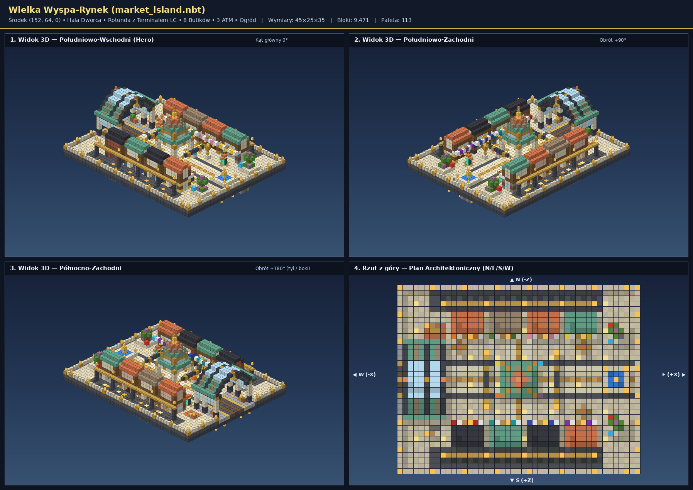
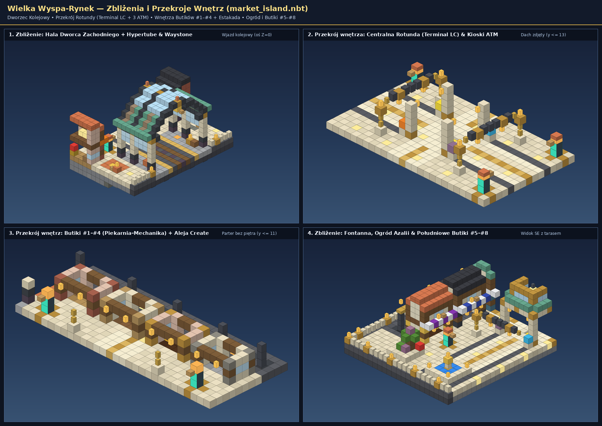
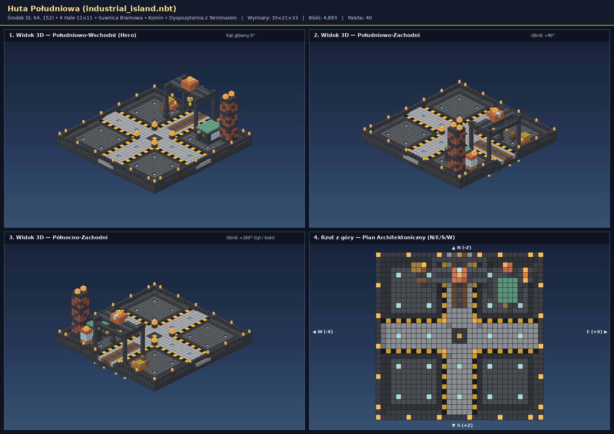
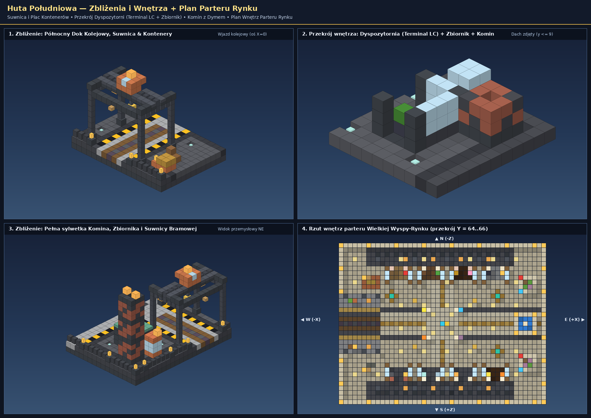
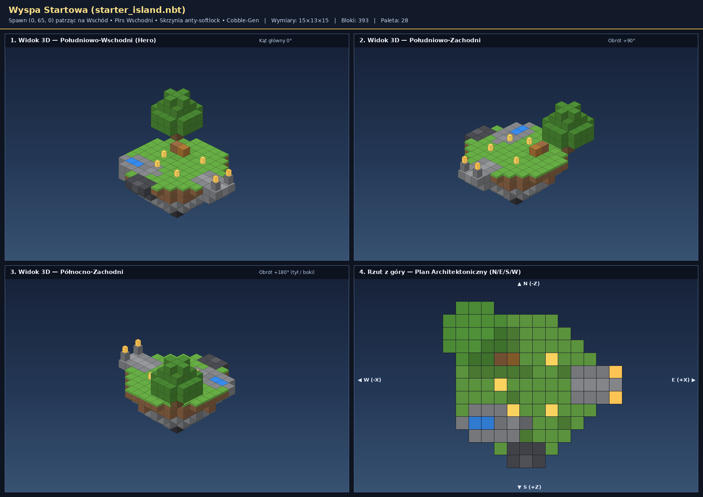

# Podgląd 3D Wysp — Galeria Zatwierdzania (`HalucynacjeGTP2`)

Ten dokument zawiera **automatycznie wyrenderowane obrazy 3D** wygenerowane bezpośrednio z rzeczywistych binarnych plików `.nbt` (`config/skyblockbuilder/templates/`), dzięki czemu można wizualnie ocenić i zatwierdzić architekturę wszystkich 3 wysp **bez wgrywania plików i bez restartowania serwera Exaroton**!

> **Interaktywny podgląd 3D z obrotem 360° i suwakiem warstw Y:**
> Pobierz i otwórz lokalnie w przeglądarce plik **[docs/renders/island_viewer_3d.html](renders/island_viewer_3d.html)** (100% offline, zero zewnętrznych bibliotek).
>
> **Regeneracja po zmianie wysp:**
> ```bash
> python3 scripts/generate_island_nbt.py
> python3 scripts/render_islands_3d.py
> ```

---

## 1. Wielka Wyspa-Rynek (`market_island.nbt` — `45 × 25 × 35`, `9 471` bloków)

- **Pozycja w świecie:** środek `(152, 64, 0)`, `offset: [152, 4, 0]` (plac 100% płaski na `Y = 64` pod pathfinding AI *Shoppers*).
- **Kluczowe elementy widoczne na renderach:**
  - **Zachodnia Hala Dworca Kolejowego** ze szklanym sklepieniem kolebkowym, miedzianymi okapami, 9-blokowym wjazdem na `Y = 65`, ładunkami bagażowymi na peronach oraz padami pod **Hypertubes** (N) i **Waystone** (S).
  - **Centralna 2-poziomowa Rotunda Giełdowa** z wielowarstwową miedzianą kopułą, iglicą do `Y = 80`, 4 donicami kwiatowymi, dwiema ozdobnymi arkadami z girlandami latarni oraz wbudowanym, działającym **`lightmanscurrency:terminal`**.
  - **8 dwupiętrowych tematycznych butików z udekorowanymi wnętrzami** (Piekarnia ze smokerem i sianem, Bistro ze stołem i beczką, Cukiernia z miodem i tulipanem, Mechanika ze stołem kowalskim, Kolej z piecem hutniczym, Elektronika AE2 z serwerem z azurytu, Mekanism z kowadłem, Bazar VIP ze sztabą monet i szmaragdem) + 3-blokowa tylna aleja automatyzacji z estakadą `createdeco:brass_catwalk`.
  - **3 działające bankomaty `lightmanscurrency:atm`** w kioskach (odstęp `>= 12` bloków) oraz **wschodni taras ogrodowy** z fontanną, doniczkami i rozłożystymi drzewkami kwitnącej azalii.



### Zbliżenia i przekroje wnętrz Wielkiej Wyspy-Rynku


---

## 2. Huta Południowa & Terminal Towarowy (`industrial_island.nbt` — `33 × 21 × 33`, `4 893` bloków)

- **Pozycja w świecie:** środek `(0, 64, 152)`, `offset: [0, 4, 152]` (płyta robocza na `Y = 64`).
- **Kluczowe elementy widoczne na renderach:**
  - **4 wielkie otwarte zatoki budowlane `11 × 11`** na ciężki przemysł Create, AE2 i Mekanism, oddzielone arteriami z pasami ostrzegawczymi, 4 słupkami świetlnymi i siatką wpuszczonych lamp `sea_lantern`.
  - **Północny Dok Kolejowy z Suwnicą Bramową** (`create:metal_girder` + `createdeco:industrial_iron_catwalk`, mosiężny hak ładunkowy wysoko nad torem) oraz **plac kontenerowy** ze skrzyniami z miedzi i mosiądzu.
  - **Ceglano-żelazny komin przemysłowy z dymem**, **przeszklony zbiornik przemysłowy z miedzi** oraz **Dyspozytornia** z wbudowanym działającym **`lightmanscurrency:terminal`**, piecem hutniczym, stołem kowalskim, rzemieślniczym i szyldem.



### Zbliżenia i przekroje wnętrz Huty Południowej + plan parteru Rynku


---

## 3. Wyspa Startowa (`starter_island.nbt` — `15 × 13 × 15`, `389` bloków)

- **Pozycja w świecie:** środek `(0, 64, 0)`, spawn `(0, 65, 0)` patrząc prosto na Wschód (wzdłuż Pirsu Wschodniego ku Wielkiej Wyspie-Rynkowi).
- **Kluczowe elementy widoczne na renderach:**
  - Naturalna latająca bryła skalna z dębem startowym, bezpieczną wnęką cobble-gen (blok lodu + kamienna niecka), skrzynią anty-softlock (11 pozycji) i stołem rzemieślniczym.
  - **Pirs Wschodni** z latarniami wskazujący oś toru na Rynek oraz **znacznik łupkowy na Południu** wskazujący kierunek na Hutę Południową.



---

## Checklista zatwierdzenia wizualnego
- [ ] Wielka Wyspa-Rynek (`market_island.nbt`) — zatwierdzona do gry / uwagi w Issue
- [ ] Huta Południowa (`industrial_island.nbt`) — zatwierdzona do gry / uwagi w Issue
- [ ] Wyspa Startowa (`starter_island.nbt`) — zatwierdzona do gry / uwagi w Issue
